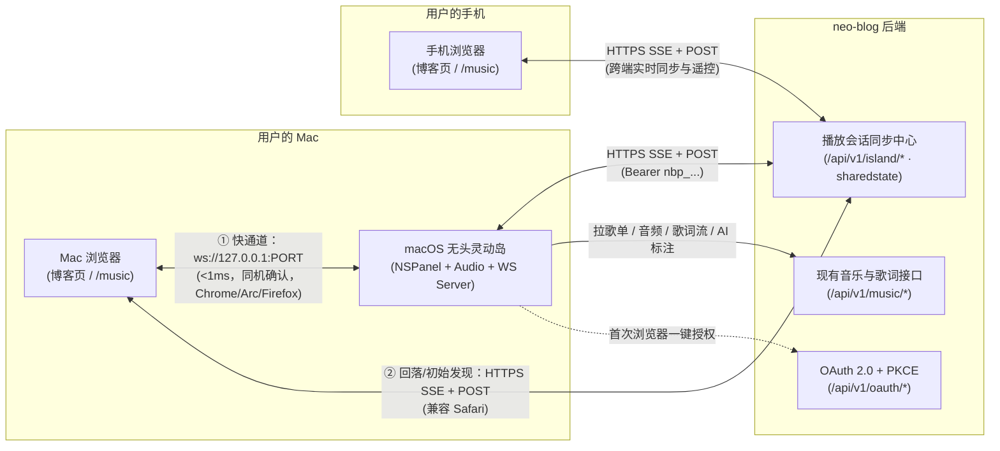

# macOS 系统灵动岛与跨端音乐联动需求规格（Spec）

> 状态：方案设计中，待实现（2026-11-16）
> 关联规格：`docs/music-player-spec.md`（音乐与歌词引擎基准）、`docs/island-arbitration-spec.md`（网页顶栏灵动岛仲裁基准）。

## 1. 目标与边界

将博客现有的音乐播放器灵动岛延伸为 **macOS 屏幕顶部的无头（Headless）系统级灵动岛组件**，并通过「本地回环快通道 + 博客后端同步通道」实现**同机网页无缝接管**与**手机 ↔ macOS 跨端联动**。

### 1.1 第一版（v1）核心目标

- **只做音乐播放器灵动岛**：完整承接音乐胶囊（旋转封面、单行逐字擦除歌词、AI 强调特效、节拍律动条、副歌情绪描边辉光、XDR 屏 HDR 高光）与点按一体展开的迷你播放器弹层。
- **无头（Headless）轻量形态**：不驻留 macOS Dock 栏、不做传统桌面音乐软件主窗口；日常在屏幕上**只有顶部灵动岛本体**（无播放活动时完全隐身），仅保留极简菜单栏入口与轻量配置/登录小窗。
- **本地 + 后端双通道互通**：
  - **同机零延迟直连**：同一台 Mac 上的主流浏览器（Chrome / Edge / Arc / Firefox）通过本地 `127.0.0.1` WebSocket 与灵动岛毫秒级互通；网页内播放器与网页顶栏灵动岛自动静音退让，关掉网页不断歌。
  - **跨端与全浏览器同步**：通过博客后端实时通道兜底 macOS Safari，并解锁 **手机端网页 ↔ macOS 灵动岛跨端联动**（手机播歌时 Mac 顶部同步展示灵动岛歌词与动效，或用手机无线遥控 Mac 播放，支持一键切换发声设备）。
- **OAuth 2.0 浏览器授权登录**：本地组件不自建账号密码与验证码表单，统一拉起系统浏览器完成博客 OAuth（Authorization Code + PKCE）一键登录授权，签发最小权限令牌。

### 1.2 阶段拆分

| 阶段 | 内容 | 说明 |
| --- | --- | --- |
| **P0：后端 OAuth 与同步信令层** | OAuth 2.0 + PKCE 授权页与换票接口、`island:sync` 权限范围、基于 `pkg/sharedstate` 的跨端播放会话同步接口（SSE + POST） | 复用现有 `api_tokens` 与 `sharedstate`，无需新建业务表 |
| **P1：网页端桥接与避让层** | `MusicProvider` 远端音源驱动模式、本地 `127.0.0.1` 自动握手与回落、同机双岛避让（`standby`）、`/music` 设备接管入口 | 普通未绑定访客零额外请求、零权限弹窗 |
| **P2：macOS 无头灵动岛组件** | `NSPanel` 置顶无焦点窗口、刘海/非刘海自适应胶囊与连续曲率展开形变、音频播放与歌词演出、本地 WS 服务、极简设置与登录窗 | 独立子目录或独立仓库维护，打包 `.dmg` 分发 |

### 1.3 非目标（v1 不做）

- **不做音乐以外的灵动岛活动**：文章阅读进度环、点赞/评论/复制操作反馈、站内未读通知、上传进度等 v1 一律不上系统岛（通信信封预留 `channel` 字段供后续版本扩展）。
- **不读取系统第三方播放器**：不监听 Apple Music、Spotify、网易云桌面客户端的播放状态，**绝不调用 `MediaRemote.framework` 等任何 Apple 私有 API**。
- **不做桌面端完整大屏窗口**：需要看全屏沉浸式歌词舞台时，点击灵动岛展开面板右上角按钮直接在默认浏览器打开 `/music` 页（声音继续由灵动岛无缝播放，网页大屏按同步时钟实时渲染歌词）。
- **不对普通访客探测本地端口**：未登录或账号下无在线桌面灵动岛时，网页绝不向 `127.0.0.1` 发任何请求，杜绝触发浏览器的「本地网络访问」权限警告。

---

## 2. 总体架构

### 2.1 双通道互通拓扑



### 2.2 为什么采用「后端发现 + 本地明文直连 + 自动回落」

1. **零证书与私钥维护成本**：不打包任何公网 TLS 私钥进客户端，无需维护 DNS-01 定期重发版，也不受 Clash / Surge Fake-IP 或路由器 DNS 重绑定保护干扰。
2. **精准免盲扫**：macOS 灵动岛启动后将本机监听端口（如 `29170`）与单次启动随机口令 `local_token` 通过后端会话下发给同一账号的网页端。网页端只在确知「名下有桌面岛在线」时才按精确端口连接，无需像旧式客户端那样轮询一串端口。
3. **自动识别「是不是同一台电脑」**：
   - 同一台 Mac 上的浏览器连 `ws://127.0.0.1:<port>` 携带 `local_token` 握手成功 → **铁证确认与灵动岛处在同一台物理 Mac** → 自动隐藏网页自身悬浮球与顶栏岛，把发声权交给系统灵动岛。
   - 手机上的浏览器（不在同一台机器，`127.0.0.1` 不通，移动端可直接跳过探测）→ 自动走后端通道 → 进入**跨端联动模式**。
   - 同一台 Mac 上的 Safari（因 WebKit Mixed Content 策略拦截 `ws://127.0.0.1`）→ 捕获同步异常后立即无缝走后端通道，并可在界面选择「由本机灵动岛播放」。

---

## 3. 跨端会话与「谁出声」仲裁模型

多端同时在线时，最核心的规则只有一条：**同一账号任意时刻最多只有 1 个设备持有「发声权（Audio Owner）」，其余在线端均为「伴显 / 遥控端（Mirror / Remote）」。**

### 3.1 四大典型场景行为

| 场景 | 发声端（Audio Owner） | macOS 灵动岛表现 | 网页端表现 |
| --- | --- | --- | --- |
| **1. 仅 Mac 灵动岛独立运行** | **Mac 灵动岛** | 正常发声，渲染胶囊歌词、律动与辉光，响应 Mac 媒体键 | 未打开 |
| **2. 同机浏览器 + Mac 灵动岛** | **Mac 灵动岛**（默认自动接管） | 正常发声与展示；关闭浏览器标签页后播放不中断 | 网页 `<audio>` 挂起静音；网页顶栏 `MusicIsland` 进入 `standby` 收起、右下角悬浮球隐藏；点文章内单曲卡直接切灵动岛的歌；打开 `/music` 页按同步时钟渲染大屏歌词 |
| **3. 手机网页点播 + Mac 亮屏在线** | **手机网页** | **静音镜像伴显态**：不出声、不下载音频流，但实时同步旋转封面、单行逐字歌词、AI 特效与副歌辉光；点按可反向遥控手机暂停/切歌，面板内可点「在此 Mac 上播放」一键接管发声权 | 手机正常发声播放，显示灵动岛已连接伴显 |
| **4. Mac 灵动岛正在播 + 手机打开博客** | **Mac 灵动岛**（保持不打断） | 继续正常发声播放 | 手机不抢断 Mac 声音，进入无线遥控视图（显示「正在 Mac 灵动岛上播放」），可直接切歌、拖进度，也可点「切到本机播放」把声音拉回手机 |

### 3.2 发声权流转规则

1. **不突然异地炸响**：某设备掉线（如手机锁屏挂起、网页关闭）导致发声端心跳超时，会话自动转为**暂停态**，绝不让远端另一台设备在无人操作时突然外放出声。
2. **谁主动点播归谁（同机伴随态除外）**：
   - 在已确认为**同机伴随**的 Mac 浏览器里点播放：始终委托本机 Mac 灵动岛发声。
   - 在独立设备（如手机）上：若当前无任何设备在播，点播放即由手机自己拿发声权；若当前 Mac 正在发声，手机端控制栏默认遥控 Mac，提供显式切换开关改变发声端。
3. **显式移交（Handoff）**：用户在任一端点击「切换到此设备播放」时，发送 `transfer_audio` 指令并附带当前精确进度 `position_ms`，原发声端立即停声让出 `audio_owner_id`，目标端从 `position_ms` 处无缝续播。

### 3.3 逐字歌词的时钟锚点同步（零高频轮询）

逐字歌词要求毫秒级对齐，但**禁止通过网络逐帧推送 `currentTime`**。采用「状态锚点 + 服务端单调时间校准」：

1. 客户端建立连接时记录一次服务端时间差：`serverOffsetMs = serverNowMs - Date.now()`（本地 `127.0.0.1` 直连时偏移视为 `0`）。
2. 发声端仅在 **开始播放、暂停、切歌、倍速/跳转（seek）** 以及 **每 5 秒一次低频心跳** 时上报锚点：
   - `is_playing`: `boolean`
   - `position_ms`: 事件发生瞬间的音频毫秒进度
   - `anchor_server_ms`: 事件发生瞬间的对齐时间戳
3. 伴显端（如静音伴显的 Mac 灵动岛，或同机打开的 `/music` 大屏页）在本地每帧（`requestAnimationFrame` / 120Hz `TimelineView`）按公式推算当前进度：
   $$\text{currentMs} = \begin{cases} \text{position\_ms} + (\text{nowAlignedMs} - \text{anchor\_server\_ms}), & \text{if is\_playing} \\ \text{position\_ms}, & \text{otherwise} \end{cases}$$
4. 收到新心跳锚点时：若推算值与新锚点偏差 `< 80ms` 则平滑微调（或保持不动避免抖动），`≥ 80ms`（发生了缓冲卡顿或跳转）则立即对齐。

---

## 4. OAuth 2.0 授权与权限设计

### 4.1 为什么采用 OAuth 2.0 + PKCE

博客现有登录链路包含人机验证（Captcha）、邮箱验证与多种第三方 OIDC 登录（`internal/router/apiv1/user.go`）。本地无头组件若自绘登录框，必须把整套验证码与第三方跳转全重做一遍。采用标准的 **OAuth 2.0 Authorization Code + PKCE（RFC 7636，公共客户端免 `client_secret`）**：

- 用户在自己平时用的浏览器里本来就已登录博客，点一下「允许授权」即可完成，全程 3 秒；
- 授权产出的长期凭据直接复用并扩展现有的 `model.APIToken` 体系（`nbp_` 前缀，库中仅存 SHA-256 哈希），用户随时可在博客「个人设置 › API Token / 已连接设备」里查看最近活跃时间并一键吊销。

### 4.2 新增权限范围（遵循最小权限原则）

在 `pkg/constant/constant.go` 中新增：

- `ScopeIslandSync = "island:sync"`：跨端音乐灵动岛状态同步与遥控。
- **角色许可**：对所有正常状态的非 AI 登录用户开放（`RoleUser` / `RoleEditor` / `RoleAdmin` 均允许，遵循 `EffectiveScopes` 角色交集机制）。
- **严格隔离**：仅持 `island:sync` 的 Token **只能访问**：
  1. `/api/v1/island/*`（灵动岛会话流、状态上报、控制指令）；
  2. `GET /api/v1/user/me`（仅用于本地设置窗展示当前登录用户的头像与昵称，或提供更精简的 `/api/v1/island/me`）；
  3. `/api/v1/music/*`（公开歌单、歌词流，以及继承该用户身份的 `/song/:id/audio` 白名单权限——例如管理员登录灵动岛后同样能播放草稿引用的歌曲）。
  - 严禁访问文章写改、评论、点赞、文件上传、MCP 或后台接口；严禁凭该 Token 再创建新 Token 或审批 OAuth 请求。

### 4.3 授权交互流程

1. **发起授权**：用户在 macOS 灵动岛设置小窗点击「登录博客账号」：
   - 本地组件生成 32 字节随机 `code_verifier` 及 `code_challenge = BASE64URL(SHA256(code_verifier))`，生成随机 `state`；
   - 在 `127.0.0.1` 临时（或复用本地 WS 端口）监听回调路径 `http://127.0.0.1:<port>/oauth/callback`（同时注册 `neoblog-island://oauth/callback` 作为备用回调）；
   - 调用系统默认浏览器打开：
     `{site_url}/oauth/authorize?client_id=macos-island&response_type=code&redirect_uri=http://127.0.0.1:<port>/oauth/callback&scope=island:sync&code_challenge=...&code_challenge_method=S256&state=...&device_name=MacBook+Pro`
2. **网页确认页（`/oauth/authorize`）**：
   - 未登录时先跳转 `/login?redirect=...`，登录完成后回到授权页；
   - 校验参数合法性（`client_id` 为内置白名单 `macos-island`；`redirect_uri` 仅允许 `http://127.0.0.1:<port>/oauth/callback` 或 `neoblog-island://oauth/callback`，**绝不允许任意外部域名重定向**）；
   - 展示清晰授权卡片：请求方名称（「macOS 音乐灵动岛」）、设备名、申请权限说明（「同步与控制你的博客音乐播放状态，无权修改文章或账号资料」），提供「允许连接」与「取消」按钮。
3. **签发一次性授权码（`POST /api/v1/oauth/authorize`）**：
   - 仅接受浏览器 Cookie 会话（拒绝 `Authorization: Bearer nbp_...` 调用）；
   - 生成高熵一次性 `code`，将 `{ user_id, client_id, redirect_uri, scope, code_challenge, device_name }` 写入 `sharedstate`（TTL `60s`）；
   - 前端拿到 `code` 后重定向至 `redirect_uri?code=...&state=...`。
4. **换取长期令牌（`POST /api/v1/oauth/token`）**：
   - 本地组件校验 `state` 一致后，提交 `{ grant_type: "authorization_code", client_id, code, redirect_uri, code_verifier }`；
   - 后端使用 `sharedstate.Current().Take(...)` **原子消费一次性 `code`**（防重放），校验 `redirect_uri` 与 `SHA256(code_verifier) == code_challenge`；
   - 调用 `APITokenService` 创建一条 `Scopes = "island:sync"`、`Name = "macOS 灵动岛 · <device_name>"` 的令牌（默认有效期如 180 天或不过期，受每用户上限管理），返回 `{ access_token: "nbp_...", token_type: "Bearer", expires_at, user: { id, nickname, avatar } }`；
   - 本地组件将 `access_token` 存入 **macOS Keychain（系统钥匙串）**，不在明文配置文件落盘。

---

## 5. 数据与接口协议

### 5.1 核心数据结构（snake_case，前后端与桌面端统一）

```jsonc
// 在线设备描述
{
  "device_id": "mac_9f8a7b6c",          // 客户端安装后持久化的随机 UUID
  "device_type": "macos_island",        // "macos_island" | "web_desktop" | "web_mobile"
  "device_name": "Snowy 的 MacBook Pro",
  "local_ws_port": 29170,               // 仅 macos_island 填写；仅下发给同一认证用户的连接
  "local_ws_token": "ephemeral_secret", // 仅 macos_island 每次启动随机生成，供同机 WS 握手鉴权
  "last_seen_ms": 1763282400000
}

// 跨端播放会话快照（PlaybackSessionState）
{
  "revision": 42,                       // 单调递增版本号，丢弃乱序旧包
  "audio_owner_id": "mac_9f8a7b6c",     // 当前持有发声权的 device_id（为空表示无活跃音源）
  "track": {                            // 当前曲目精简元信息（允许接收端未拉全歌单前立刻渲染胶囊）
    "id": 476513774,
    "name": "琵琶行",
    "artists": ["奇然", "沈谧仁"],
    "album": "琵琶行",
    "album_pic": "https://...",
    "duration": 332.4
  },
  "is_playing": true,
  "play_mode": "repeat-all",            // "repeat-all" | "repeat-one" | "shuffle"
  "position_ms": 48210,
  "anchor_server_ms": 1763282400120,
  "volume": 0.8,
  "muted": false
}

// 跨端控制指令（PlaybackCommand）
{
  "command_id": "cmd_01j...",
  "from_device_id": "web_iphone_01",
  "target_device_id": "mac_9f8a7b6c",   // 为空时发给当前 audio_owner_id
  "action": "play_song",                // "play" | "pause" | "toggle" | "next" | "prev" | "seek" | "set_mode" | "set_volume" | "play_song" | "transfer_audio"
  "payload": {
    "track": { /* play_song 时携带曲目，兼容文章内歌单外白名单单曲 */ },
    "position_ms": 12500,               // seek / play_song / transfer_audio 可选
    "play_mode": "shuffle",             // set_mode 时携带
    "volume": 0.6                       // set_volume 时携带
  }
}
```

### 5.2 后端同步接口（`/api/v1/island/*`）

同时支持**浏览器登录 Cookie** 或 **`Bearer nbp_...`（需含 `island:sync` scope）** 鉴权；多副本部署下状态全部存放在 `pkg/sharedstate`（不写数据库），沿用 `edit_session.go` / `notification.go` 成熟的 **SSE + POST** 架构：

| 接口 | 用途 | 关键规则 |
| --- | --- | --- |
| `GET /api/v1/island/stream?device_id=...&device_type=...&device_name=...` | SSE 实时订阅流 | 建立连接后先推一条 `ready`（含 `server_now_ms`、当前用户的在线 `devices` 列表、当前 `session` 快照）；每 20s 发送 `: ping` 心跳注释，单连接最长 30 分钟后自动重连；每用户跨实例限制最大并发连接数（如 6 条，防资源耗尽） |
| `POST /api/v1/island/heartbeat` | 设备在线续期与本地端口登记 | `macos_island` 携带 `{ device_id, local_ws_port, local_ws_token }` 注册/续期在线状态（TTL `60s`）；设备列表变化时通过 `sharedstate.Publish` 通知同账号其他连接 |
| `POST /api/v1/island/state` | 发声端上报播放状态锚点 | 校验请求方 `device_id == audio_owner_id`（或当前无主 / 显式接管时抢占），`revision` 原子递增并写入 `sharedstate`（TTL `90s`），广播 `state` 事件给同账号其余连接 |
| `POST /api/v1/island/command` | 遥控端发送控制指令 / 接管音源 | 广播 `command` 事件至目标设备；若 `action == "transfer_audio"`，原子更新 `audio_owner_id` 为新设备并广播最新 `state` |

### 5.3 本地回环快通道协议（`ws://127.0.0.1:<port>/ws`）

macOS 灵动岛组件在本地绑定 **`127.0.0.1`**（严禁绑定 `0.0.0.0`，杜绝局域网其他设备未授权连入），默认尝试端口 `29170`（若被占用依次顺延至 `29174`）：

1. **安全握手三重校验**：
   - **校验 1（IP 层）**：仅监听 `127.0.0.1` 回环网卡；
   - **校验 2（`Origin` 头）**：WebSocket Upgrade 请求的 `Origin` 必须精确匹配用户在灵动岛设置中配置的 `site_url` origin（开发模式下额外允许 `http://localhost:3000`），不匹配直接返回 `403`；
   - **校验 3（`local_ws_token`）**：连接参数 `?token=<local_ws_token>&device_id=<web_device_id>` 必须与灵动岛上报给后端的当次随机密钥一致（用常量时间比较），杜绝同机其他陌生网页盲连控制。
2. **消息复用**：连上后直接双向收发 5.1 定义的 `{ type: "state" | "command" | "ping", data: ... }` JSON 帧。一旦本地 WS 处于 `OPEN` 状态，同机网页与灵动岛之间的控制与进度同步直接走本地通道（`< 1ms`），不再重复调后端 `/island/command`。

---

## 6. macOS 无头灵动岛组件设计

### 6.1 进程与窗口层级（纯公开 API）

- **无头应用属性**：`Info.plist` 设置 `LSUIElement = YES`（不显示在 Dock 与 `Cmd+Tab` 应用切换器中，无顶部应用菜单栏）。
- **灵动岛承载窗口（`NSPanel`）**：
  - `styleMask = [.borderless, .nonactivatingPanel]`（点击切歌、拖动进度条、展开面板时**不抢夺当前前台软件的键盘输入焦点**）；
  - `level = .statusBar + 1`（或高于菜单栏层级），`collectionBehavior = [.canJoinAllSpaces, .fullScreenAuxiliary, .stationary, .ignoresCycle]`（在所有桌面空间与全屏应用上方常驻）；
  - 窗口背景全透明（`isOpaque = false, backgroundColor = .clear, hasShadow = false`），窗口矩形在胶囊/面板外围留出 **`40pt` 透明出血区**，专门用于绘制副歌情绪外发光与展开大阴影，确保不被窗口边界裁切；
  - **鼠标穿透**：实时根据当前胶囊/展开面板的实际几何区域动态设置 `panel.ignoresMouseEvents`（或子视图 `hitTest`），透明出血区的所有点击与悬停 100% 穿透给底下的菜单栏和桌面软件。

### 6.2 屏幕与刘海自适应布局

通过公开 API `NSScreen.safeAreaInsets.top`、`auxiliaryTopLeftArea` 与 `auxiliaryTopRightArea` 检测当前屏幕是否存在物理摄像头刘海：

1. **有刘海屏（MacBook Pro / Air 内建屏幕）**：
   - **连体融合态**：胶囊上边缘紧贴屏幕物理顶边（顶角为贴边直角或反向耳翼圆角，底角为连续曲率圆角），纯黑底色与物理刘海融为一体：
     - 刘海左侧翼展示旋转圆形封面，右侧翼展示 5 根节拍律动条（暂停时为播放图标）；
     - 单行逐字特效歌词位于紧贴刘海下沿的延伸窄条区（高度约 `26pt`），避免文字被物理摄像头遮挡；前奏无词且未切歌时下巴收起，仅保留左右两翼极简展示。
2. **无刘海屏（外接显示器 / iMac / Mac mini）**：
   - **顶部胶囊态**：与网页版 `TopbarIsland` 外观一致的四面连续曲率黑色胶囊（高度 `36pt`），水平居中贴近屏幕顶边；布局直接采用 `[旋转封面 | 单行逐字特效歌词 | 节拍律动条]`。
   - **菜单栏避让**：当用户鼠标移入系统顶部菜单栏左侧文字菜单区且未停留在胶囊本身时，可微调不透明度或短暂上收，避免挡住超长软件菜单。
3. **多显示器策略**：默认显示在主屏幕（`NSScreen.main`，即当前键鼠活跃屏幕或配置锁定的指定屏幕）。

### 6.3 视觉与交互对齐清单

| 状态 | 行为规格（对齐 `music-island.tsx` 与 `music-player-spec.md`） |
| --- | --- |
| **空闲隐藏** | 无曲目播放、未暂停驻留、且远端无活跃播放会话时，窗口停止一切动画渲染并隐藏，CPU / GPU 占用归零 |
| **播放紧凑态** | 模糊专辑封面暗底 + 旋转封面 + 单行逐字扫词（含 AI 短语强调色/放大/颤音/辉光、粒子点缀）+ 5 根随节拍起伏染色的律动条；副歌段（`/song/:id/chorus`）胶囊外圈亮起随歌词情绪变化的描边辉光；支持 XDR 屏幕时律动条与高光启用原生 EDR 超白亮度 |
| **切歌瞬态** | 切歌且首句未开唱时短暂显示歌名与歌手（`1.5s`），第一句开唱即刻让位给逐字歌词 |
| **暂停驻留态** | 停止封面转动与粒子，中间定格为暂停那一刻的那句歌词（间奏或无词时为歌名），右侧换为播放图标，胶囊宽度以弹簧收拢至文字宽度；点击直接继续播放（右键或长按可完全收起隐藏） |
| **远端镜像态** | 手机等其他设备持有发声权时，不出声但完整演出上述紧凑态动画；鼠标悬停或展开面板时显示小角标「正在手机上播放」，带一键「切到此 Mac 播放」按钮 |
| **展开迷你播放器** | 点按胶囊（或长按）以弹簧曲线（响应 `0.38s`、阻尼比 `0.75`）原地向下撑开为连续曲率大圆角（`32pt`）深色模糊封面面板：封面从圆形边转正边放大落位；含歌名歌手跑马灯、多行紧凑歌词舞台（可点行跳转、可滚轮浏览、翻译/音译开关）、进度条、播放模式、上一首/暂停/下一首、音量滑块、歌单小浮层、右上角「在浏览器打开完整歌词页 `/music`」按钮；点击面板外区域或上滑手势缩回胶囊 |
| **系统媒体控制** | 当灵动岛持有发声权（或连接了在线远端发声端）时，接入 macOS `MPNowPlayingInfoCenter` 与 `MPRemoteCommandCenter`：Mac 键盘 `F7/F8/F9` 媒体键、AirPods 捏合与控制中心均可直接切歌/暂停 |

### 6.4 极简无头配置界面

除了顶部灵动岛外，在 macOS 右上角菜单栏放置一个单色小音符图标（`NSStatusItem`，可在设置中关闭图标改为仅右键灵动岛呼出菜单），点开提供一页极简设置小窗（宽约 `320pt`）：

1. **博客站点地址**：默认填入主站地址（如 `https://...`），校验 `https://`（本地开发允许 `http://localhost:3000`）。
2. **账号连接（OAuth）**：
   - 未登录：显示「使用浏览器登录博客账号」按钮（注：未登录时也可作为纯独立桌面播放器播放博客公开歌单，只是不开启跨端联动）；
   - 已登录：显示头像、昵称、「已连接跨端同步」绿点与「退出登录」按钮。
3. **联动与显示偏好**：
   - 「同机打开博客时自动接管播放」（默认开）；
   - 「其他设备（如手机）播放时在灵动岛伴随显示」（默认开）；
   - 「显示屏幕选择」（跟随活跃屏幕 / 仅内建刘海屏 / 指定显示器）；
   - 「开机自动启动」（`SMAppService.mainApp`）。
4. **退出灵动岛**。

### 6.5 客户端渲染技术选型（P2 动手前二选一）

两种实现方式对外遵循**完全相同的 OAuth、后端 SSE 与本地 WS 协议**，互不影响后端与网页端开发：

- **路线 A（快速高还原）：`Swift AppKit 外壳（NSPanel + AVPlayer + 本地 WS + 媒体键） + 透明 WKWebView 渲染层`**
  - 直接复用本仓库打磨成熟的 TTML 解析、借补对齐、32 色 AI 特效演出、粒子画布与 `island-morph.ts` 形变代码（构建为独立嵌入式静态包打入 `.app` 包内，离线秒开）；
  - Swift 层仅约 300–400 行，负责刘海窗口定位、透明区鼠标穿透、Keychain 存 Token、系统媒体键与本地 WebSocket 服务。适合不懂 SwiftUI 但追求第一版 100% 视觉一致与极速交付。
- **路线 B（极致原生低占用）：`纯原生 AppKit + SwiftUI + Metal`**
  - 内存占用更低（`~40MB` vs WebView `~120MB`）、与刘海物理边缘和 120Hz ProMotion 的原生排版结合最紧密；
  - 需用 Swift 重新实现一份歌词解析、对齐与逐字特效渲染器。可在路线 A 验证完体验后作为后续迭代，或直接借助 AI 编写原生视图。

---

## 7. 博客网页端（`web/`）改造设计

严格保持最小侵入，复用现有 `MusicProvider`（`web/src/contexts/music-context.tsx`）与 `TopbarIsland`（`web/src/components/layout/topbar-island/`）：

1. **按需挂载联动模块（不进未登录访客首屏包）**：
   - 仅当 `useCurrentUser()` 存在已登录用户（且站点开启了音乐播放器）时，异步加载 `island-bridge.ts` 建立 `/api/v1/island/stream` 连接；未登录访客完全不加载联动代码、不发任何请求。
2. **本地快通道自动升级**：
   - 从 SSE `ready` / `devices` 事件收到在线的 `macos_island` 带有 `local_ws_port` 与 `local_ws_token` 时：
     - 若当前为移动端（User-Agent / 触屏窄视口）则跳过本地回环探测，直接使用后端通道；
     - 若为桌面浏览器且用户开启过（或首次点击控制栏「连接桌面灵动岛」触发授权），尝试连接 `ws://127.0.0.1:<port>/ws?token=...`；
     - 握手成功即标记 `sameMachineIsland = true`；若报错（如其他电脑上的浏览器，或同机 Safari 拦截明文 WS），静默回落至后端通道，不弹错误提示。
3. **音源模式切换（Local Audio vs Remote Clock）**：
   - 当 `audio_owner_id` 为本网页自己时：沿用现有 `<audio>` 播放，并在播放/暂停/切歌/跳转时顺手调用后端上报状态（同机 WS 已连时直发本地）。
   - 当 `audio_owner_id` 为远端设备（如本机 `macos_island` 或手机）时：
     - 暂停并静音网页自己的 `<audio>`；
     - `useMusicClockStore()` 切换为由 3.3 节的**远端锚点推算时钟**驱动，使 `/music` 大屏歌词舞台无需修改任何渲染代码即可直接跟随远端声音逐字扫词；
     - `useMusicActions()` 中的 `play / pause / next / prev / seek / playSong` 自动转发为 `PlaybackCommand`。
4. **同机双岛避让**：
   - `web/src/components/layout/topbar-island/music-island.tsx`：`standby` 条件扩展为 `floatingOpen || sameMachineIsland`——同机 Mac 灵动岛在线接管时，网页顶栏里的音乐胶囊自动收起；
   - `web/src/components/common/music-player.tsx`：同机接管时隐藏右下角悬浮球（用户仍在屏幕顶部的系统灵动岛随时控播）；
   - `/music` 播放器页与悬浮播放器控制栏旁增加轻量设备胶囊（如 `MacBook 灵动岛播放中`），点击可展开设备列表并一键切换「在此浏览器播放 / 在 Mac 灵动岛播放」。

---

## 8. 安全与异常兜底

1. **保守授权与权限校验**：
   - OAuth 授权码接口强制要求浏览器会话登录态；`redirect_uri` 严格限制在 `127.0.0.1` 回环地址或注册的自定义协议，杜绝开放重定向与 Token 劫持。
   - `/api/v1/island/*` 严格按 `user_id` 隔离命名空间，任何用户只能看到并控制自己账号下的设备会话。
2. **本地端口防跨站劫持（CSRF / DNS Rebinding）**：
   - 本地 WebSocket 仅监听 `127.0.0.1`，强制校验 `Origin` 头 + 高熵 `local_ws_token`（每次灵动岛启动轮换，仅通过已鉴权的后端 HTTPS SSE 下发给本人）。恶意第三方网站即使扫到端口也因无 `Origin` 许可与无 `local_ws_token` 在握手阶段即被拒绝。
3. **异常熔断与防炸响**：
   - 沿用 `music-player-spec.md` 5.2 的连续异常完播熔断与系统媒体控制切歌风暴熔断规则；
   - Mac 合盖休眠（`NSWorkspace.willSleepNotification`）时，若灵动岛持有发声权，主动暂停并上报 `is_playing: false`，避免唤醒或超时造成跨端状态悬空。

---

## 9. 待确认项

动手实现前只需拍板以下 3 个小决策：

1. **macOS 灵动岛渲染层选型（6.5 节）**：第一版倾向于 **路线 A（`Swift NSPanel 外壳 + 透明 WKWebView` 直接复用现有前端逐字歌词与 AI 特效代码，最快做出完全一致的视觉）**，还是 **路线 B（纯原生 `SwiftUI` 从头写一套歌词与特效渲染）**？
2. **未登录访客是否需要联动**：v1 按你提到的「博客开 OAuth 登录」统一以**登录同一账号**作为本地+跨端联动的唯一身份纽带（最干净，顺带天然打通手机 ↔ Mac）；是否还需要额外支持「不登录账号、输 6 位临时配对码」？建议 v1 不做免登录配对，保持简单。
3. **代码存放位置**：macOS 客户端代码是放在本仓库子目录（如 `clients/macos-island/`，方便共享类型与构建），还是单独开一个新仓库？
